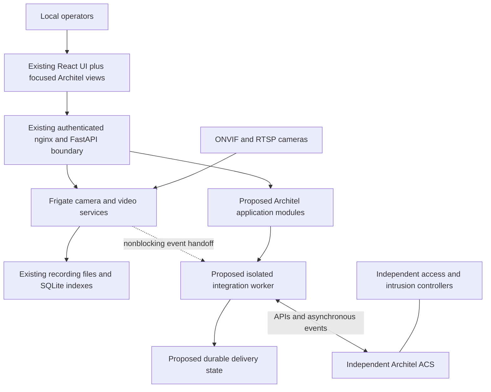

# Architel VMS architecture and repository audit

Audit date: 2026-11-06. Baseline: `1cb5ec410` (working tree includes local
development changes). This is a source audit, not production certification or
a comparison of every change against upstream. Features below are observed in
this checkout, regardless of their original author. Proposed modules are labeled
explicitly. No major source refactor was performed for this audit.

Related documents: [Roadmap](ROADMAP.md), [Decisions](DECISIONS.md),
[Integrations](INTEGRATIONS.md).

## Deployment context and ownership

The initial target is the Victorian Pride Centre in Melbourne: approximately
78 Hikvision cameras currently spread across three NVRs. Camera models, firmware,
stream bitrates, network access, storage requirements, and server hardware have
not been verified. Production is dedicated Ubuntu Server hardware with local
operation during internet and ACS outages. This Mac's development environment
does not establish production performance or hardware compatibility.

Architel VMS owns video configuration, streams, recording, retention, playback,
exports, analytics, and video-specific events. Architel ACS owns access-control
identities, permissions, credentials, doors, security alarms, and their audit
history. VMS still requires local application authorization and independent
emergency administration. Mapping ACS identities into VMS access is an unresolved
integration decision, not an implemented identity service. Hikvision access
controllers and Protege WX intrusion equipment must retain independent operation.

## Existing implementation

### Browser application

Evidence: [`web/package.json`](../../web/package.json),
[`App.tsx`](../../web/src/App.tsx), [`providers.tsx`](../../web/src/context/providers.tsx).

- React 19, strict TypeScript, Vite 8, React Router 7. `BrowserRouter` routes to
  live, review, explore, export, settings, system, config, logs, faces,
  classification, chat, and replay pages. Pages are lazy loaded. Login has a
  separate HTML/React entry. A first-run setup wizard includes admin password,
  camera, acceleration, detection, and recording steps.
- Tailwind 3, CSS theme variables, Radix-based UI components, `cn()`, Lucide and
  React Icons. Existing dialogs, tables, forms, navigation, timelines, and players
  should remain the component foundation. RJSF/shadcn, React Hook Form and Zod
  support configuration and validation; Monaco supports YAML editing.
- Axios and SWR provide API access/caching; React contexts/hooks manage auth,
  themes, streaming settings, and status. WebSockets supply runtime state.
  i18next/react-i18next and local translation JSON provide localization.
- Camera groups, layouts, stream selection, visibility handling, and the
  `LiveStreamGovernor` already address multi-camera viewing. They have not been
  demonstrated with 78 real cameras and multiple operators.

### Runtime, API, and persistence

Evidence: [`app.py`](../../frigate/app.py),
[`fastapi_app.py`](../../frigate/api/fastapi_app.py),
[`models.py`](../../frigate/models.py), [`comms`](../../frigate/comms).

The Python application orchestrates camera capture/processing, detectors,
recording, review, embeddings/enrichments, audio, output, events, timeline,
cleanup, stats, and watchdog workers. It uses multiple processes, threads,
queues/shared memory, and ZeroMQ IPC. It is not a fleet of independent HTTP
microservices. s6 supervises services in the container; nginx fronts FastAPI,
go2rtc, media, and WebSocket endpoints.

FastAPI routers separate app/config, cameras, auth, events, review, media,
recordings, exports, previews, hardware, notifications, notices, motion search,
classification, chat, and debug replay. nginx exposes the API under `/api`.
Authorization defaults to admin with route-specific public, authenticated,
role, or camera checks. The generated API spec records auth requirements.

Peewee/SQLite stores events, recordings, timeline, previews, users, review
segments and per-user review state, triggers, exports/cases, and notices.
`peewee_migrate` applies numbered migrations; SQLite queue/WAL patterns support
writer coordination. SQLite-vec supports embedding search. YAML remains the
camera/configuration source, with Pydantic validation, runtime config holders,
section update publications, profiles, and persisted runtime overrides.
Some settings hot apply; others require restart. This is not a transactionally
unified configuration database and should not be described as one.

### Cameras and discovery

Evidence: [`camera.py`](../../frigate/api/camera.py),
[`camera config`](../../frigate/config/camera/camera.py),
[`CameraWizardDialog`](../../web/src/components/settings/CameraWizardDialog.tsx),
[`CameraManagementView`](../../web/src/views/settings/CameraManagementView.tsx).

Existing capabilities include camera naming/friendly names, add/edit/clone/delete,
stream configuration, go2rtc stream management, ffprobe diagnostics and snapshots,
and ONVIF probing of an explicitly supplied host. Probe code queries device/media/
PTZ capabilities and stream candidates, with authentication compatibility paths.
ONVIF PTZ and autotracking exist. FFmpeg supports separate detection, main
recording, sub recording, and audio roles.

Single-host probing is not subnet discovery. No WS-Discovery implementation or
complete bulk inventory/import workflow was found in the camera API/wizard and
repository searches. Nor was a migration adapter for the site's three NVRs found.
Generic ONVIF/RTSP is the first integration path; it does not prove support for
every Hikvision firmware or private NVR camera network.

### Live and recorded video

Evidence: [`players`](../../web/src/components/player),
[`media.py`](../../frigate/api/media.py),
[`RecordingView`](../../web/src/views/recording/RecordingView.tsx),
[`nginx`](../../docker/main/rootfs/usr/local/nginx/conf/nginx.conf).

go2rtc restreams camera sources for browser MSE/WebRTC players. JSMpeg and Birdseye
output paths also exist. Automatic live stream selection can step down through
configured streams to JSMpeg, with delivery feedback, retry/backoff, and visibility
checks. Browser codec support and WebRTC network paths still need site testing.

Recordings are indexed segments, not browser-generated video. FastAPI constructs
time-range/event VOD mappings; nginx-vod delivers playlists/media; hls.js/native
video handles browser playback. Main/sub stream selection, coverage/gaps,
previews, seeking, audio/codec transition handling, snapshots, and clip endpoints
are implemented. Recording review includes a main player and other camera
previews. Do not equate that with a verified synchronized multi-camera forensic
playback wall; establish operator requirements before adding one.

### Recording, retention, storage, and exports

Evidence: [`record`](../../frigate/record),
[`record config`](../../frigate/config/camera/record.py),
[`storage.py`](../../frigate/storage.py), [`export API`](../../frigate/api/export.py).

FFmpeg produces cached segments; the recording maintainer associates metadata and
moves eligible segments into recording storage. Retention distinguishes
continuous, motion, alerts, and detections, with pre/post capture and separate
sub-stream policies. Cleanup removes expired segments, previews, and review data.
Storage metrics estimate bandwidth and remaining capacity. Media sync/reindex
jobs and database migration/backup mechanisms exist.

Low-space cleanup starts when free space is below approximately one hour of
estimated recording writes. It can ultimately remove recordings associated with
`retain_indefinitely` events and sets `retention_unmet`. Existing retain flags are
therefore not a guaranteed evidence preservation mechanism. Export cases,
queued export jobs, concurrency limits, progress, clips/timelapse, and chapter
metadata already exist. No complete immutable evidence manifest, custody audit,
or tested disaster-recovery procedure was identified. Export grouping is not
itself an incident-management or evidence-integrity system.

Storage paths are rooted under `/media/frigate`, with config/database/model cache
under `/config` and temporary cache under `/tmp/cache`. Host disks/RAID/mounts,
failure policy, backups, and capacity are deployment responsibilities; this
checkout does not establish a multi-volume storage scheduler or automatic HA.

### Events, detection, review, and search

Evidence: [`events`](../../frigate/events), [`review`](../../frigate/review),
[`event API`](../../frigate/api/event.py),
[`motion search`](../../frigate/api/motion_search.py),
[`embeddings`](../../frigate/embeddings),
[`data processing`](../../frigate/data_processing).

Motion gating, object tracking, masks/zones, detector backends, snapshots, and
audio processing provide video analytics. Review segments summarize alerts and
detections, with per-user reviewed state. APIs support time/camera/label/zone
filters, metadata updates, retention flags, manual event creation, and timelines.
Semantic image/text search uses embeddings; motion search runs cancellable jobs.
Face recognition, license plate recognition, classification, transcription,
GenAI descriptions, and chat code are present, with feature/model dependencies.

Local inference is available, but model acquisition may download assets at first
use. Optional GenAI providers and Frigate+ paths can use external services.
Browser web push is also not a guaranteed offline notification channel. Offline
release acceptance must preload required models and test every enabled feature
with external networking blocked. Presence of analytics code does not establish
accuracy, suitability, or approval for the site's operational use.

### Security and administration

Evidence: [`auth.py`](../../frigate/api/auth.py),
[`media_auth.py`](../../frigate/api/media_auth.py),
[`auth config`](../../frigate/config/auth.py),
[`AuthenticationView`](../../web/src/views/settings/AuthenticationView.tsx).

Native local users, PBKDF2 password hashing, JWT sessions/cookies, session
invalidation on account changes, password-strength checks, optional login rate
limits, and proxy-header authentication exist. Admin/viewer and custom
camera-list roles exist. HTTP media, go2rtc, and WebSocket authorization include
camera checks; outbound WebSocket topics are fail-closed. TLS and configurable
listeners are supported. These are source observations, not proof of complete
security coverage.

The internal port (default 5000) grants anonymous admin. Our development Compose
binds it to loopback and Vite proxies to it. That setup bypasses login and cannot
validate authenticated operator workflows. The production authenticated listener
defaults to 8971; internal services must not be exposed to untrusted networks.
The original devcontainer Compose also exposes a no-auth MQTT broker, so neither
development Compose file is a production deployment specification.

No dedicated ACS federation client, OIDC/SAML implementation, or comprehensive
VMS action audit ledger was found. Proxy auth is an extension point, not proof of
an implemented ACS identity integration. Camera-list roles do not yet constitute
a separately modeled capability matrix for export, deletion, PTZ, and retention.

### Communications, diagnostics, build, and deployment

Evidence: [`dispatcher`](../../frigate/comms/dispatcher.py),
[`MQTT`](../../frigate/comms/mqtt.py), [`WebSocket`](../../frigate/comms/ws.py),
[`stats`](../../frigate/stats), [`notices`](../../frigate/notices),
[`Dockerfile`](../../docker/main/Dockerfile),
[`CI`](../../.github/workflows/pull_request.yml).

The dispatcher connects optional MQTT, WebSocket, WebPush, and internal IPC.
MQTT supports topic prefixes, commands, availability, state/events, TLS, and QoS.
Reconnect logic replays retained/runtime state; non-retained event publication
is not a durable application outbox. WebSocket client queues/timeouts limit slow
clients. Neither transport provides the proposed ACS delivery contract today.

System pages expose camera/general/enrichment/health/storage metrics, service
logs, ffprobe, keyframe analysis, hardware probes, and replay diagnostics.
Stats/history and Prometheus endpoints exist. Notices persist operational
conditions with acknowledgment/muting; watchdogs restart failed workers. These
are useful foundations, not a full audited alarm service or external monitoring
deployment.

Python unittest suites include camera lifecycle, retention/storage, ONVIF,
MQTT, auth/media/WS filtering, profiles, exports, and notices. Playwright uses
mock API/WS fixtures in desktop/mobile projects, so it does not prove physical
camera, storage, or network behavior. CI also runs Ruff, mypy, frontend build,
ESLint, i18n extraction checks, and generated auth spec checks.

Docker provides dependencies/devcontainer/final image stages and hardware
variants, with s6/nginx/go2rtc and multiarchitecture build targets. Vite provides
frontend HMR; the local dependency-only container mounts Python source and needs
a restart after Python edits. Production must package the built frontend and
source into a versioned final image rather than rely on these development mounts.

Toolchain discrepancy: `AGENTS.md` states Python 3.13+, but Docker installers,
CI, and Ruff target Python 3.11. Docker/CI web stages use Node 20 while this
Mac used Node 26. Runtime/toolchain alignment needs an explicit tested decision.
The root license file declares MIT; dependency, bundled binary, model, and
redistribution obligations need a separate release inventory. There is no basis
here to claim that every optional model/service meets the no-recurring-fee goal.

## Gap analysis

| Requirement | Classification | Reuse and remaining work |
| --- | --- | --- |
| Core local recording, streams, playback | Reuse, validate | Existing FFmpeg/go2rtc/nginx pipeline; prove sustained Ubuntu operation and codec compatibility |
| Camera management and ONVIF | Extend | Reuse wizard/probe/clone/settings; add measured bulk onboarding and inventory where needed |
| Approximately 78 cameras | Unproven capacity | Benchmark bitrate, decode, inference, I/O, DB queries and browser concurrency before sizing |
| Retention and capacity management | Extend | Existing policies/cleanup/metrics; approve capacity, pressure behavior and evidence preservation requirements |
| Exports and investigations | Extend | Existing cases/jobs; add required integrity, audit and operator workflow without replacing export engine |
| Video analytics/review/search | Reuse, validate | Existing local features; preload models, measure accuracy and resource budgets |
| Local administration and permissions | Extend | Existing users/camera roles; production auth validation, capability decisions and VMS audit |
| ACS and equipment independence | Preserve and test | Core has no ACS dependency identified; prove outages cannot affect video; hardware autonomy is a site acceptance item |
| ACS integration | New adapter | No ACS client/contract/outbox found; establish ownership, mappings, auth and delivery semantics |
| Monitoring/diagnostics | Extend | Existing notices/stats/Prometheus/logs; add runbooks, service objectives and local alert delivery as required |
| Fully offline operation | Extend packaging/testing | Local core exists; remove essential first-use downloads and external notification/model assumptions |
| No recurring software fees | Release constraint | Select locally available unrestricted-by-subscription features; inventory dependencies/models before release |
| Production operations | New deployment package plus reuse | Versioned Ubuntu deployment, backup/restore, upgrades/rollback and recovery exercises |
| Multi-site reuse | Design constraint | Configurable site mappings and adapters; no initial requirement for cloud fleet management |

## Proposed modular architecture (not implemented)

Keep a modular monolith for VMS application concerns, with the existing video
worker architecture. Prefer focused Architel namespaces for new inventory,
VMS audit/evidence policy, and integration mapping code, using existing API,
config, job, UI, and persistence patterns. Exact directories are a design choice
for each implementation, not existing packages. Do not create a second recorder,
camera registry, user store, or search engine simply to obtain Architel branding.

The ACS adapter should run outside capture/recording critical paths, with its
own bounded resource budget and durable delivery state. A sidecar process is a
candidate, not a finalized deployment requirement. Avoid sharing databases or
granting ACS direct access to internal admin ports. Pass references and authorized
deep links rather than video bytes in event messages. ACS outages must never
stall recording or block local emergency administration.

Preserve existing camera names as operational identifiers for now. If stable
site/device UUIDs are needed, map them to existing names before attempting key
migration. Keep UTC instants in contracts and display local time appropriately;
verify Melbourne daylight-saving boundaries in playback/export acceptance tests.

## Audit limits and validation

This audit inspected source/configuration, workflow definitions, model/migration
structures, and existing test coverage. It did not execute full backend/frontend
tests, benchmark 78 cameras, inspect the site's equipment, conduct a penetration
test, validate vendor APIs, or certify licensing. Earlier development bring-up
verified the local backend health/API and Vite config proxy with zero cameras.
Only documentation is changed in this stage; validate Markdown links and diff
whitespace. Production claims require the acceptance work in the roadmap.
